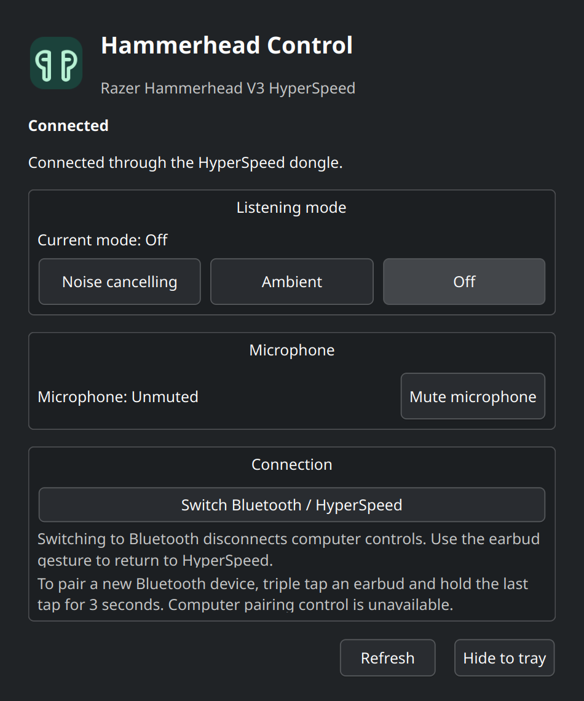

# Hammerhead Control

Native Qt 6 controls for **Razer Hammerhead V3 HyperSpeed** earbuds on Linux,
with a KDE system tray and signed APT updates. Controls the USB dongle
(`1532:0a61`) directly; OpenRazer, Synapse and a phone are not required.



## Install

Download the `.deb` from the [latest release](https://github.com/abdooay/hammerhead-control/releases/latest), then install it with APT:

```sh
sudo apt install ./hammerhead-control_0.1.2_all.deb
sudo apt update
```

The installer adds the desktop launcher, device permissions, and the signed
APT source at `https://abdooay.github.io/hammerhead-control/apt/`. Open
**Hammerhead Control** from your application menu, or run `hammerhead-control`.
No reboot or login autostart is required. Requirements: Python 3.10+, PyQt6
6.4+, and a local Linux desktop session. Tested on KDE Plasma/Wayland with
Ubuntu 26.04; CI builds and tests on Ubuntu 24.04.

## Update and remove

New published versions arrive through your normal APT updates:

```sh
sudo apt update
sudo apt install --only-upgrade hammerhead-control
```

Removing the app with `apt remove` retains its APT source and signing key,
so reinstalling stays possible. To remove both the app and its update source:

```sh
sudo apt purge hammerhead-control
```

Restart the app after an upgrade to load the new version. The signing key is
scoped to this repository using `Signed-By`; it is not added to APT's global
trusted keyring. The full fingerprint is in
[packaging/archive-key.fingerprint](packaging/archive-key.fingerprint).

## Controls

- **Noise cancelling / Ambient / Off:** sets the mode, then reads it back
  from the earbuds before selecting the button. The current ANC level is preserved.
- **Mute / Unmute microphone:** controls the earbud hardware mute, with confirmed
  device readback. Available in the window, tray, and CLI. Gesture changes appear
  on the next five-second refresh.
- **Switch Bluetooth / HyperSpeed:** sends Razer's source-toggle command.
  Switching to Bluetooth disconnects computer controls. Triple-tap an earbud
  to return to HyperSpeed; the app reconnects on its next five-second poll.
- **Hide to tray:** keeps quick controls in the system tray. Closing the window
  exits the app. Launching it again raises the existing window.

**Bluetooth discoverable pairing is not implemented.** Triple-tap an earbud
and hold the last tap for three seconds. No guessed pairing commands are sent.
The app targets the V3 HyperSpeed specifically, not other Hammerhead variants.

## Keyboard shortcuts and CLI

KDE custom shortcuts can run any of these commands:

```sh
hammerhead-control --noise anc
hammerhead-control --noise ambient
hammerhead-control --noise off
hammerhead-control --mic mute
hammerhead-control --mic unmute
hammerhead-control --mic toggle
hammerhead-control --switch-source
hammerhead-control --status
hammerhead-control --version
```

Device-operation results are JSON; failures return a nonzero exit status.
Hardware access is serialized between the GUI and CLI. `--pair` reports that
pairing is unsupported and makes no device changes.

## Development

```sh
sudo apt install python3-pyqt6 qt6-wayland apt-utils gnupg desktop-file-utils
./run.sh
QT_QPA_PLATFORM=offscreen /usr/bin/python3 -m unittest discover -s tests -v
python3 packaging/build_deb.py
```

Use the system Python with Qt bindings. If developing without installing the
package, device access can be enabled with
`pkexec "$PWD/system/enable-device-access.sh"` after inspecting the helper.
This is unnecessary for APT installations.

The tests cover captured report encoding, response validation, disconnected
and unsupported replies, preserved ANC level, verified readback, GUI errors,
serialized requests, package contents and reproducible builds. Live device
checks verified ANC, ambient, off, microphone mute/unmute readback, source switching, and reconnection after
the physical gesture. See the [protocol notes](docs/protocol.md) for source
provenance and limitations, and [release instructions](docs/releases.md) for
publishing updates.

## License

GPL-3.0-or-later. This is an independent project, not affiliated with Razer.
Razer's proprietary middleware is not included in the source or installer.
